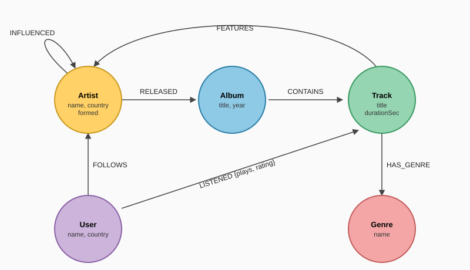
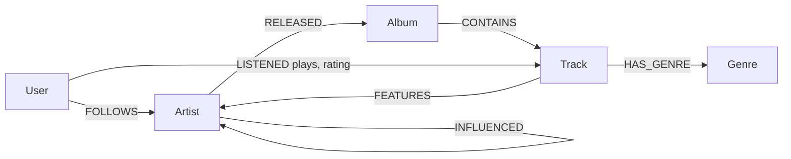
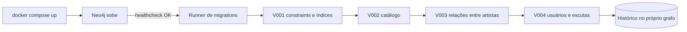
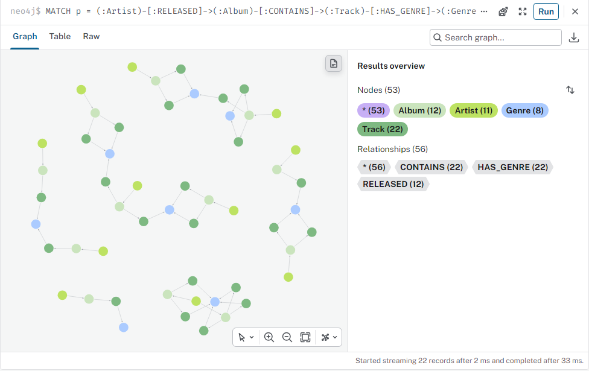
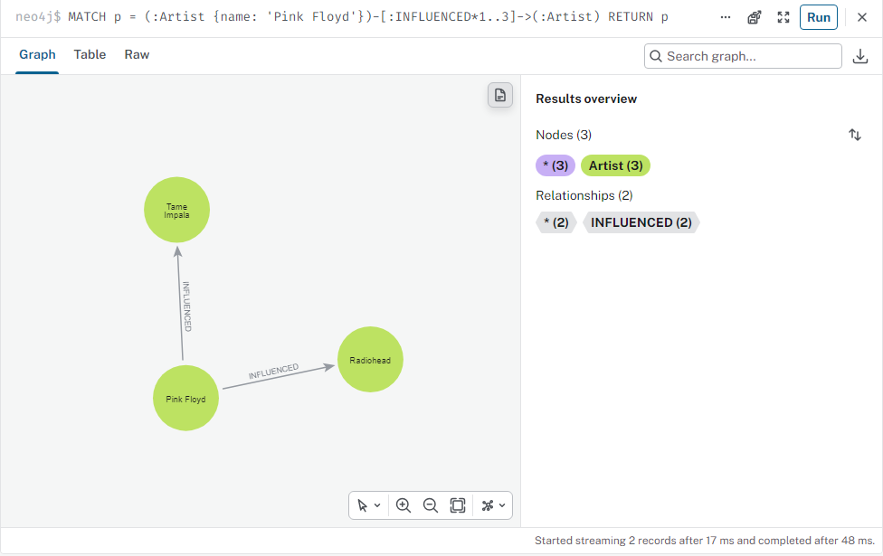
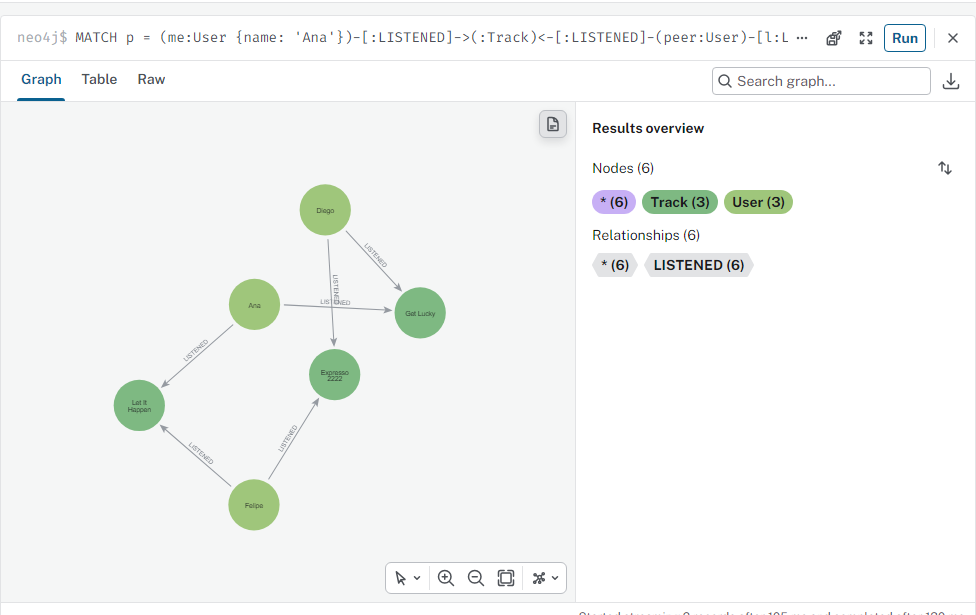
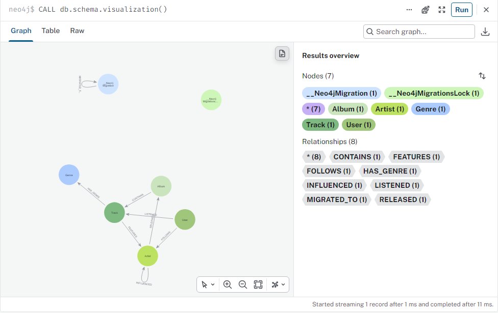

# 🎵 Music Oracle

> Grafo de descoberta musical em **Neo4j**, com schema e carga versionados por migrations (estilo Flyway) e ambiente reproduzível com um único comando.


Conecta artistas, álbuns, faixas, gêneros e ouvintes para responder perguntas que, em um
modelo relacional, exigiriam muitos `JOIN`s: **recomendação por ouvintes parecidos**,
**cadeias de influência** entre artistas, colaborações e perfil de consumo.

## Sumário

1. [Início rápido](#1-início-rápido)
2. [Problema e por que grafos](#2-problema-e-por-que-grafos)
3. [Modelo do grafo](#3-modelo-do-grafo)
4. [Migrations versionadas](#4-migrations-versionadas)
5. [Dataset e carga](#5-dataset-e-carga)
6. [Perguntas de negócio e resultados](#6-perguntas-de-negócio-e-resultados)
7. [Troubleshooting](#7-troubleshooting)
8. [Estrutura do repositório](#8-estrutura-do-repositório)
9. [Próximos passos](#9-próximos-passos)

## 1. Início rápido

Pré-requisito: Docker com Compose.

```powershell
git clone https://github.com/Gtvnv/Music-Oracle.git
cd Music-Oracle
Copy-Item .env.example .env      # defina uma senha própria
docker compose up -d --build     # sobe o Neo4j e aplica as migrations
```

Em bash/zsh, troque o segundo comando por `cp .env.example .env`.

Depois abra o **Neo4j Browser** em <http://localhost:7474> (usuário e senha do `.env`) e rode,
por exemplo, o catálogo completo:

```cypher
MATCH p = (:Artist)-[:RELEASED]->(:Album)-[:CONTAINS]->(:Track)-[:HAS_GENRE]->(:Genre)
RETURN p LIMIT 60;
```

| Quero... | Comando |
|----------|---------|
| Conferir a aplicação das migrations | `docker compose logs migrations` |
| Reaplicar (idempotente) | `docker compose run --rm migrations` |
| Executar todas as queries e salvar a evidência | `./scripts/run-queries.ps1` |
| Parar mantendo os dados | `docker compose down` |
| Resetar tudo | `docker compose down -v` |

Para consultar o estado das migrations (os argumentos do compose são substituídos, por isso
a conexão é informada de novo):

```powershell
docker compose run --rm migrations --location=file:///migrations `
  --address=bolt://neo4j:7687 --username=neo4j --password=<sua-senha> info
```

```
| Version | Description               | Type   | State   | Source                                 |
| 001     | constraints and indexes   | CYPHER | APPLIED | V001__constraints_and_indexes.cypher   |
| 002     | load catalog              | CYPHER | APPLIED | V002__load_catalog.cypher              |
| 003     | load artist relationships | CYPHER | APPLIED | V003__load_artist_relationships.cypher |
| 004     | load users and listens    | CYPHER | APPLIED | V004__load_users_and_listens.cypher    |
```

## 2. Problema e por que grafos

Plataformas de música vivem de **relacionamentos**: quem ouviu o quê, quem influenciou
quem, quem participou de qual faixa. As perguntas de negócio são, em essência,
travessias:

- Quem ouve o que eu ouço e o que mais essas pessoas gostam? (2 a 3 saltos)
- Quem foi influenciado, direta ou indiretamente, por um artista? (profundidade variável)
- Que artistas atravessam gêneros diferentes?

| | SQL relacional | Grafo (Cypher) |
|---|---|---|
| Salto extra | novo `JOIN` | mais um trecho no padrão |
| Profundidade variável | CTE recursiva | `[:INFLUENCED*1..3]` |
| Custo da consulta | cresce com o tamanho das tabelas | cresce com o trecho do grafo percorrido |
| Leitura | tabelas de junção e chaves | `(:User)-[:LISTENED]->(:Track)` |

Os relacionamentos são armazenados como ponteiros entre nós, o que torna as travessias
baratas e o modelo próximo de como o domínio é descrito.

## 3. Modelo do grafo





| Label | Propriedades | Restrição |
|-------|--------------|-----------|
| `Artist` | `id`, `name`, `country`, `formed` | `id` único |
| `Album` | `id`, `title`, `year` | `id` único |
| `Track` | `id`, `title`, `durationSec` | `id` único |
| `Genre` | `id`, `name` | `id` e `name` únicos |
| `User` | `id`, `name`, `country` | `id` único |

Relacionamento com propriedades: `(:User)-[:LISTENED {plays, rating}]->(:Track)`.

**Decisão de modelagem:** o gênero fica na **faixa** e não no artista, pois um artista pode
transitar entre gêneros (ex.: Pink Floyd, Kendrick Lamar). O gênero do artista é derivado
por travessia (Q5).

Para ver o esquema direto do banco: `CALL db.schema.visualization()` no Neo4j Browser.

## 4. Migrations versionadas

O schema e a carga de dados são tratados como código, com
[Neo4j-Migrations](https://github.com/michael-simons/neo4j-migrations), a ferramenta
inspirada no Flyway para Neo4j.



| Versão | Script | O que faz |
|--------|--------|-----------|
| V001 | `constraints_and_indexes` | unicidade por `id` (e `Genre.name`) e índices em `Artist.name` e `Track.title` |
| V002 | `load_catalog` | gêneros, artistas, álbuns e faixas via `LOAD CSV` |
| V003 | `load_artist_relationships` | `FEATURES` e `INFLUENCED` |
| V004 | `load_users_and_listens` | usuários, `LISTENED` e `FOLLOWS` |

Boas práticas aplicadas:

- Arquivos `V<versão>__<descrição>.cypher`, aplicados em ordem e **uma única vez**.
- Histórico no próprio grafo (`__Neo4jMigration`), com checksum para detectar alteração de
  scripts já aplicados.
- Cargas idempotentes: constraints primeiro (V001) e `MERGE` em todos os `LOAD CSV`.
- Mudança futura vira nova versão (`V005__...`), nunca edição de uma antiga.
- `healthcheck` + `depends_on: service_healthy`: as migrations só rodam com o banco pronto.
- Credenciais em `.env` (fora do Git), com `.env.example` versionado.
- A imagem do runner baixa o release oficial e valida o **SHA-256** antes de usar.

## 5. Dataset e carga

Amostra pequena e didática em `data/`, com artistas, álbuns e faixas reais. Durações e
relações de influência são aproximadas e ilustrativas; ouvintes e históricos de escuta
são fictícios.

| Arquivo | Linhas | Conteúdo |
|---------|-------:|----------|
| `genres.csv` | 8 | gêneros |
| `artists.csv` | 14 | artistas |
| `albums.csv` | 12 | álbuns e autoria |
| `tracks.csv` | 22 | faixas, álbum e gênero |
| `features.csv` | 4 | participações |
| `influences.csv` | 6 | influência entre artistas |
| `users.csv` | 6 | ouvintes |
| `listens.csv` | 30 | reproduções e nota |
| `follows.csv` | 16 | quem segue quem |

Resultado após a carga:

| Nós | Qtd | Relacionamentos | Qtd |
|-----|----:|-----------------|----:|
| `Artist` | 14 | `CONTAINS` | 22 |
| `Track` | 22 | `HAS_GENRE` | 22 |
| `Album` | 12 | `LISTENED` | 30 |
| `Genre` | 8 | `FOLLOWS` | 16 |
| `User` | 6 | `RELEASED` | 12 |
| | | `INFLUENCED` | 6 |
| | | `FEATURES` | 4 |

Trecho comentado de `V002`:

```cypher
// Faixas, (Album)-[:CONTAINS]->(Track) e (Track)-[:HAS_GENRE]->(Genre)
LOAD CSV WITH HEADERS FROM 'file:///tracks.csv' AS row
MATCH (al:Album {id: toInteger(row.albumId)})
MATCH (g:Genre  {id: toInteger(row.genreId)})
MERGE (t:Track {id: toInteger(row.id)})
SET t.title = row.title, t.durationSec = toInteger(row.durationSec)
MERGE (al)-[:CONTAINS]->(t)
MERGE (t)-[:HAS_GENRE]->(g);
```

## 6. Perguntas de negócio e resultados

Todas em [`queries/business_queries.cypher`](queries/business_queries.cypher). A saída
completa, gerada pelo `run-queries.ps1`, está em [`docs/query-results.txt`](docs/query-results.txt).

| # | Pergunta | Técnica |
|---|----------|---------|
| Q1 | Quais as faixas mais tocadas? | agregação em travessia de 4 saltos |
| Q2 | Que gêneros são mais bem avaliados? | agregação em propriedade de relacionamento |
| Q3 | O que recomendar à Ana? | filtragem colaborativa, `NOT pattern` |
| Q4 | Quem o Pink Floyd influenciou, direta ou indiretamente? | caminho de tamanho variável |
| Q5 | Quais artistas cruzam gêneros? | `collect` + `size` |
| Q6 | Quais faixas têm participações? | padrão com 3 saltos |
| Q7 | Que artistas sugerir pela influência do que a Carla segue? | travessia + exclusão |
| Q8 | Que países de artistas cada país de ouvinte mais toca? | agregação multidimensional |
| Q9 | Quantas horas cada usuário ouviu? | cálculo com propriedades de nó e relacionamento |
| Q10 | Visão geral do catálogo | retorna caminhos para a visualização em grafo |

### Q1 · Faixas mais tocadas

| Faixa | Artista | Reproduções |
|-------|---------|------------:|
| Get Lucky | Daft Punk | 48 |
| Kill Bill | SZA | 45 |
| Expresso 2222 | Gilberto Gil | 42 |
| Time | Pink Floyd | 42 |
| Karma Police | Radiohead | 40 |

### Q2 · Gêneros por nota média

| Gênero | Nota média | Ouvintes | Reproduções |
|--------|-----------:|---------:|------------:|
| MPB | 4.67 | 2 | 70 |
| Jazz | 4.67 | 1 | 69 |
| Soul | 4.50 | 2 | 23 |
| Electronic | 4.20 | 2 | 121 |
| Rock | 4.20 | 2 | 103 |
| Psychedelic | 4.17 | 4 | 98 |
| R&B | 4.00 | 1 | 88 |
| Hip Hop | 3.67 | 2 | 37 |

### Q3 · Recomendação para a Ana (filtragem colaborativa)

Faixas bem avaliadas (nota 4 ou mais) por quem escutou as mesmas músicas que a Ana e que
ela ainda não ouviu.

```cypher
MATCH (me:User {name: 'Ana'})-[:LISTENED]->(:Track)<-[:LISTENED]-(peer:User)
WHERE peer <> me
WITH me, peer, count(*) AS sharedTracks
MATCH (peer)-[l:LISTENED]->(rec:Track)
WHERE l.rating >= 4 AND NOT (me)-[:LISTENED]->(rec)
RETURN rec.title AS recommendation, sum(sharedTracks) AS score,
       collect(DISTINCT peer.name) AS recommendedBy
ORDER BY score DESC, recommendation
LIMIT 5;
```

| Recomendação | Score | Indicada por |
|--------------|------:|--------------|
| Expresso 2222 | 2 | Diego, Felipe |
| Alright | 1 | Diego |
| Kill Bill | 1 | Emma |
| Money | 1 | Felipe |
| Paranoid Android | 1 | Felipe |

### Q4 · Cadeia de influência do Pink Floyd

```cypher
MATCH path = (:Artist {name: 'Pink Floyd'})-[:INFLUENCED*1..3]->(b:Artist)
RETURN b.name AS influenced, length(path) AS hops, [n IN nodes(path) | n.name] AS chain
ORDER BY hops, influenced;
```

| Influenciado | Saltos | Caminho |
|--------------|-------:|---------|
| Radiohead | 1 | Pink Floyd → Radiohead |
| Tame Impala | 1 | Pink Floyd → Tame Impala |

### Q5 a Q9 · Resumo

| Query | Resultado |
|-------|-----------|
| Q5 · artistas que cruzam gêneros | Kendrick Lamar (R&B, Hip Hop) e Pink Floyd (Psychedelic, Rock) |
| Q6 · participações | Get Lucky (Pharrell Williams), Giorgio by Moroder (Giorgio Moroder), Instant Crush (Julian Casablancas), Tropicalia (Gilberto Gil) |
| Q7 · sugestão para a Carla | Tame Impala, porque ela segue Pink Floyd |
| Q8 · BR ouve mais | FR (121), US (106), BR (70), GB (57), AU (42) |
| Q9 · horas de escuta | Ana 12.7 · Bruno 9.6 · Felipe 9.5 · Carla 8.5 · Emma 6.4 · Diego 5.3 |

### Evidências visuais

Capturas reais do Neo4j Browser, geradas sobre o banco criado pelas migrations.

**Catálogo (Q10):** 53 nós e 56 relacionamentos. Cada ramo é Artista → Álbum → Faixa → Gênero.



**Influências (Q4):** o Pink Floyd influenciou Radiohead e Tame Impala.



**Recomendação (Q3):** Ana e Felipe escutaram *Let It Happen*; Felipe e Diego avaliaram bem
*Expresso 2222*, que a Ana ainda não ouviu. (Diego e Ana também escutaram *Get Lucky*.)



**Esquema (`db.schema.visualization()`):** além do domínio, aparecem os nós
`__Neo4jMigration` e `__Neo4jMigrationsLock`, usados pela ferramenta de migrations.



## 7. Troubleshooting

Problemas reais encontrados durante o desenvolvimento.

| Sintoma | Causa | Solução |
|---------|-------|---------|
| `error from registry: denied` ao baixar `ghcr.io/michael-simons/neo4j-migrations` | Não há imagem pública mantida para as versões atuais | `tools/migrations/Dockerfile` baixa o release oficial do GitHub e valida o SHA-256 |
| Neo4j sai com `chown ... Read-only file system` | O entrypoint faz `chown` no diretório `import`, que não pode ser montado como `:ro` | Montar `./data:/var/lib/neo4j/import` sem `:ro` |
| `Cannot find migrations as neither locations nor packages to scan are configured!` | O CLI não tem local padrão de scripts | Passar `--location=file:///migrations` |
| `exec: "neo4j-migrations": executable file not found in $PATH` | O `.zip` perde o bit de execução | `chmod +x` no binário, dentro do Dockerfile |
| `cypher-shell` para silenciosamente no meio do script | Aspas duplas dentro de comentário `//` confundem o parser | Evitar aspas nos comentários dos `.cypher` |
| Migrations rodando antes de o banco aceitar conexões | `depends_on` simples não espera o banco ficar pronto | `healthcheck` no Neo4j + `condition: service_healthy` |
| Q7 retornava vazio para o Bruno | Tudo que os artistas dele influenciaram ele já segue | Exemplo trocado para a Carla; resultado vazio é válido e não é erro |

## 8. Estrutura do repositório

```
.
├── docker-compose.yml                # Neo4j + runner de migrations
├── .env.example                      # credenciais (copie para .env)
├── data/                             # CSVs de amostra (montados no import do Neo4j)
├── migrations/                       # scripts Cypher versionados
│   ├── V001__constraints_and_indexes.cypher
│   ├── V002__load_catalog.cypher
│   ├── V003__load_artist_relationships.cypher
│   └── V004__load_users_and_listens.cypher
├── queries/business_queries.cypher   # perguntas de negócio (Q1 a Q10)
├── scripts/run-queries.ps1           # executa as queries e salva a evidência
├── tools/migrations/Dockerfile       # imagem com o Neo4j-Migrations CLI
└── docs/                             # modelo, resultados e prints
```

## 9. Próximos passos

- Índice full-text em artistas e faixas.
- Projeção do GDS (Louvain e PageRank) para comunidades e artistas centrais.
- Dataset maior (MusicBrainz) com `LOAD CSV` em lotes (`CALL { } IN TRANSACTIONS`).
- Pipeline de CI que sobe o Neo4j e valida as migrations a cada PR.
