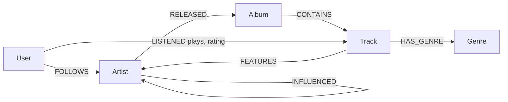

# Music Oracle - grafo de descoberta musical com Neo4j

Banco de dados em grafo que conecta artistas, álbuns, faixas, gêneros e ouvintes
para responder perguntas que, em um modelo relacional, exigiriam muitos `JOIN`s:
recomendação por ouvintes parecidos, cadeias de influência entre artistas,
colaborações e perfil de consumo.

## 1. Problema e por que grafos

Plataformas de música vivem de **relacionamentos**: quem ouviu o quê, quem influenciou
quem, quem participou de qual faixa. As perguntas de negócio são, em essência,
travessias:

- "Quem ouve o que eu ouço e o que mais essas pessoas gostam?" (2-3 saltos)
- "Quem foi influenciado, direta ou indiretamente, por um artista?" (profundidade variável)
- "Que artistas atravessam gêneros diferentes?"

Em SQL, profundidade variável exige CTEs recursivas e cada salto extra é um novo `JOIN`.
Em Cypher, é um padrão: `(a)-[:INFLUENCED*1..3]->(b)`. Os relacionamentos são
armazenados como ponteiros, então o custo da consulta depende do trecho do grafo
percorrido, não do tamanho total das tabelas.

## 2. Modelo do grafo




| Label | Propriedades | Restrição |
|-------|--------------|-----------|
| `Artist` | `id`, `name`, `country`, `formed` | `id` único |
| `Album` | `id`, `title`, `year` | `id` único |
| `Track` | `id`, `title`, `durationSec` | `id` único |
| `Genre` | `id`, `name` | `id` e `name` únicos |
| `User` | `id`, `name`, `country` | `id` único |

Relacionamento com propriedades: `(:User)-[:LISTENED {plays, rating}]->(:Track)`.

Decisão de modelagem: o gênero fica na **faixa** e não no artista, pois um artista pode
transitar entre gêneros (ex.: Pink Floyd, Kendrick Lamar). O gênero do artista é derivado
por travessia (query Q5).

Para ver o esquema direto do banco: `CALL db.schema.visualization()` no Neo4j Browser.

## 3. Estrutura do repositório

```
.
├── docker-compose.yml          # Neo4j + runner de migrations
├── .env.example                # credenciais (copie para .env)
├── data/                       # CSVs de amostra (montados no import do Neo4j)
├── migrations/                 # scripts Cypher versionados (estilo Flyway)
│   ├── V001__constraints_and_indexes.cypher
│   ├── V002__load_catalog.cypher
│   ├── V003__load_artist_relationships.cypher
│   └── V004__load_users_and_listens.cypher
├── queries/business_queries.cypher   # perguntas de negócio (Q1..Q10)
├── scripts/run-queries.ps1     # executa as queries e salva a evidência
├── tools/migrations/Dockerfile # imagem com o Neo4j-Migrations CLI
└── docs/                       # modelo, resultados e prints
```

### Padrão adotado: migrations versionadas

O schema e a carga de dados são tratados como código, com
[Neo4j-Migrations](https://github.com/michael-simons/neo4j-migrations), a ferramenta
inspirada no Flyway para Neo4j:

- Arquivos `V<versão>__<descrição>.cypher`, aplicados em ordem e **uma única vez**.
- O histórico fica no próprio grafo (`__Neo4jMigration`), com checksum para detectar
  alteração de scripts já aplicados.
- Cargas idempotentes: constraints primeiro (V001) e `MERGE` nos `LOAD CSV`.
- Qualquer mudança futura vira uma nova versão (`V005__...`), nunca edição de uma antiga.
- Ambiente reproduzível via Docker Compose: um comando sobe banco e aplica as migrations.

## 4. Como executar

Pré-requisito: Docker com Compose.

```powershell
Copy-Item .env.example .env      # ajuste a senha
docker compose up -d --build     # sobe o Neo4j e aplica as migrations
docker compose logs migrations   # confira "Database migrated to version 004"
```

- Neo4j Browser: http://localhost:7474 (usuário/senha do `.env`)
- Reaplicar migrations (idempotente): `docker compose run --rm migrations`
- Ver estado: `docker compose run --rm migrations info` (os argumentos do compose são
  substituídos, então informe também `--location`, `--address`, `--username` e `--password`).
- Resetar tudo: `docker compose down -v`

Rodar as queries e gerar a evidência:

```powershell
./scripts/run-queries.ps1        # grava docs/query-results.txt
```

## 5. Dataset e carga

Amostra pequena e didática em `data/`, com artistas, álbuns e faixas reais. Durações e
relações de influência são aproximadas/ilustrativas; ouvintes e históricos de escuta
são fictícios.

| Arquivo | Linhas | Conteúdo |
|---------|-------:|----------|
| `genres.csv` | 8 | gêneros |
| `artists.csv` | 14 | artistas |
| `albums.csv` | 12 | álbuns e autoria |
| `tracks.csv` | 22 | faixas, álbum e gênero |
| `features.csv` | 4 | participações |
| `influences.csv` | 6 | influência entre artistas |
| `users.csv` | 6 | ouvintes |
| `listens.csv` | 30 | reproduções e nota |
| `follows.csv` | 16 | quem segue quem |

Resultado após a carga: 62 nós de domínio e 112 relacionamentos de domínio. Exemplo comentado
(trecho de `V002`):

```cypher
// Faixas, (Album)-[:CONTAINS]->(Track) e (Track)-[:HAS_GENRE]->(Genre)
LOAD CSV WITH HEADERS FROM 'file:///tracks.csv' AS row
MATCH (al:Album {id: toInteger(row.albumId)})
MATCH (g:Genre  {id: toInteger(row.genreId)})
MERGE (t:Track {id: toInteger(row.id)})
SET t.title = row.title, t.durationSec = toInteger(row.durationSec)
MERGE (al)-[:CONTAINS]->(t)
MERGE (t)-[:HAS_GENRE]->(g);
```

## 6. Perguntas de negócio

Todas em [`queries/business_queries.cypher`](queries/business_queries.cypher); saída real em
[`docs/query-results.txt`](docs/query-results.txt).

| # | Pergunta | Técnica |
|---|----------|---------|
| Q1 | Faixas mais tocadas | agregação em travessia de 4 saltos |
| Q2 | Gêneros mais bem avaliados | agregação em propriedade de relacionamento |
| Q3 | O que recomendar à Ana? | filtragem colaborativa, `NOT pattern` |
| Q4 | Quem o Pink Floyd influenciou (direta/indiretamente)? | caminho de tamanho variável |
| Q5 | Artistas que cruzam gêneros | `collect` + `size` |
| Q6 | Quais faixas têm participações? | padrão com 3 saltos |
| Q7 | Que artistas sugerir pela influência do que a Carla segue? | travessia + exclusão |
| Q8 | Que países de artistas cada país de ouvinte mais toca? | agregação multi-dimensão |
| Q9 | Tempo total de escuta por usuário | cálculo com propriedades de nó e relacionamento |
| Q10 | Visão geral do catálogo para print | retorna caminhos para o grafo |

Exemplo (Q3, recomendação para a Ana):

```cypher
MATCH (me:User {name: 'Ana'})-[:LISTENED]->(:Track)<-[:LISTENED]-(peer:User)
WHERE peer <> me
WITH me, peer, count(*) AS sharedTracks
MATCH (peer)-[l:LISTENED]->(rec:Track)
WHERE l.rating >= 4 AND NOT (me)-[:LISTENED]->(rec)
RETURN rec.title AS recommendation, sum(sharedTracks) AS score,
       collect(DISTINCT peer.name) AS recommendedBy
ORDER BY score DESC, recommendation LIMIT 5;
```

```
recommendation     score  recommendedBy
"Expresso 2222"    2      ["Diego", "Felipe"]
"Alright"          1      ["Diego"]
"Kill Bill"        1      ["Emma"]
```

Outros resultados (Q1 e Q4):

```
track            artist          totalPlays        influenced     hops  chain
"Get Lucky"      "Daft Punk"     48                "Radiohead"    1     [Pink Floyd, Radiohead]
"Kill Bill"      "SZA"           45                "Tame Impala"  1     [Pink Floyd, Tame Impala]
"Expresso 2222"  "Gilberto Gil"  42
```

### Evidências visuais

Os prints do Neo4j Browser ficam em [`docs/img/`](docs/img/README.md) (rode a Q10 para o
catálogo e a Q4 para as influências).

## 7. Troubleshooting (problemas reais encontrados)

| Sintoma | Causa | Solução |
|---------|-------|---------|
| `error from registry: denied` ao baixar `ghcr.io/michael-simons/neo4j-migrations` | Não existe imagem pública mantida para as versões atuais | Criei `tools/migrations/Dockerfile`, que baixa o release oficial do GitHub e valida o SHA-256 |
| Neo4j sai com `chown ... Read-only file system` | O entrypoint do Neo4j faz `chown` no diretório `import`; ele não pode estar montado como `:ro` | Montar `./data:/var/lib/neo4j/import` sem `:ro` |
| `Cannot find migrations as neither locations nor packages to scan are configured!` | O CLI não tem local padrão de scripts | Passar `--location=file:///migrations` |
| `exec: "neo4j-migrations": executable file not found in $PATH` | O `.zip` perde o bit de execução | `chmod +x` do binário no Dockerfile |
| Em `cypher-shell`, o script para silenciosamente no meio | Aspas duplas dentro de comentário `//` confundem o parser | Evitar aspas em comentários dos `.cypher` |
| Migrations rodando antes de o banco aceitar conexões | `depends_on` simples não espera o banco ficar pronto | `healthcheck` no Neo4j + `condition: service_healthy` |
| Query Q7 retornando vazio para o Bruno | Dado de exemplo: tudo que os artistas dele influenciaram ele já segue | Trocar o exemplo para a Carla (e documentar que vazio é um resultado válido) |

## 8. Próximos passos

- Índice full-text em artistas e faixas.
- Projeção do GDS (Louvain/PageRank) para comunidades e artistas centrais.
- Dataset maior (MusicBrainz) com `LOAD CSV` em lotes (`CALL { } IN TRANSACTIONS`).
- Pipeline de CI que sobe o Neo4j e valida as migrations a cada PR.

